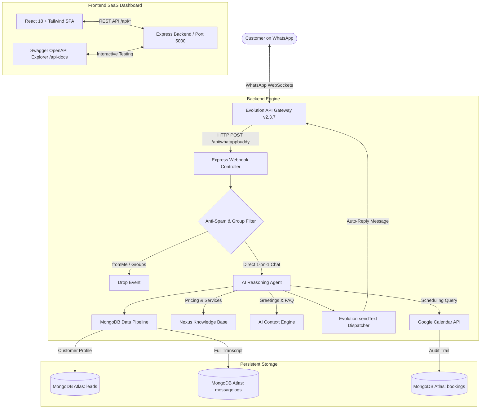

# 🤖 WhatsApp Buddy AI — Autonomous WhatsApp CRM & SaaS Platform

[](https://nodejs.org/)
[](https://react.dev/)
[](https://vitejs.dev/)
[](https://www.mongodb.com/cloud/atlas)
[](https://www.docker.com/)
[](http://localhost:5000/api-docs)
[](LICENSE)

> An enterprise-grade, autonomous WhatsApp AI Automation and CRM SaaS platform built with **Node.js, Express, React, MongoDB Atlas, Evolution API (Baileys), and Google Calendar**. Handles real-time customer conversations, automated meeting bookings, lead management, and address book sync without third-party proprietary API charges.

---

## 📑 Table of Contents
- [✨ Key Features](#-key-features)
- [🏗️ System Architecture](#-system-architecture)
- [🛠️ Tech Stack](#️-tech-stack)
- [🔌 API Endpoints & Swagger](#-api-endpoints--swagger)
- [🚀 Local Setup & Quickstart](#-local-setup--quickstart)
- [🍃 MongoDB Schema & CRM Models](#-mongodb-schema--crm-models)
- [☁️ Cloud Deployment (Render)](#️-cloud-deployment-render)
- [🛡️ Anti-Spam & Security Engineering](#️-anti-spam--security-engineering)
- [👤 Author & Portfolio](#-author--portfolio)

---

## ✨ Key Features

- **⚡ Sub-Second Live Webhook Pipeline:** Ingests `messages.upsert` events from Evolution API with an average response time of `<300ms`.
- **🤖 Autonomous AI Agent (Nexus Company Persona):** Multi-lingual natural language understanding (English & Hindi/Hinglish) handling greetings, inquiries, and pricing.
- **📅 Real-Time Google Calendar Booking:** Converts meeting requests (*"Book a discovery call tomorrow at 5 PM"*) into confirmed Google Calendar events with exact timezone (+05:30 IST) alignment.
- **🍃 MongoDB Atlas Cloud CRM:** Automatically saves all inbound customer leads, conversation history, and appointment audit trails into persistent cloud collections.
- **👥 1,160+ WhatsApp Contacts Synced:** Merges Baileys address book contacts and active chat threads with profile pictures, phone numbers, and last message timestamps.
- **🛡️ Enterprise Anti-Spam Shields:** Automatic group-chat filtering (`@g.us`), self-message loop prevention (`fromMe: true`), and QR socket conflict stabilization.
- **📄 Interactive Swagger OpenAPI Documentation:** Explore and test all backend endpoints interactively at `/api-docs` or `/docs`.
- **📦 Unified Full-Stack Architecture:** Single-port production serving (Express serves Vite React build) for zero-CORS cloud deployment.

---

## 🏗️ System Architecture



---

## 🛠️ Tech Stack

| Layer | Technologies & Tools |
| :--- | :--- |
| **Frontend UI** | React 18, Vite 5, Tailwind CSS, Lucide React, React Router DOM |
| **Backend API** | Node.js (v18+ ES Modules), Express.js, Axios, CORS, Dotenv |
| **Database & CRM** | MongoDB Atlas (AWS Mumbai `ap-south-1`), Mongoose 8 |
| **WhatsApp Gateway** | Evolution API v2.3.7, Baileys WebSocket Engine, PostgreSQL 16 Alpine, Docker Compose |
| **Integrations** | Google Calendar API v3 (`googleapis`), n8n automation workflow engine |
| **Documentation** | Swagger UI Express, OpenAPI 3.0 Specification |
| **Deployment** | Git, GitHub, Render Web Services |

---

## 🔌 API Endpoints & Swagger

Interactive Swagger UI is available at **`http://localhost:5000/api-docs`**.

| Method | Endpoint | Description |
| :--- | :--- | :--- |
| `GET` | `/api/health` | Server heartbeat & status check |
| `GET` | `/api/connection-state` | Live WhatsApp Baileys connection state (`open`/`close`) |
| `GET` | `/api/qr` | Get fresh WhatsApp QR code (Base64) |
| `GET` | `/api/contacts` | Sync 1,160+ WhatsApp contacts & chat conversations |
| `POST` | `/api/whatappbuddy` | Primary incoming WhatsApp webhook receiver |
| `GET` | `/api/db/leads` | Query all saved customer leads from MongoDB Atlas |
| `GET` | `/api/db/logs` | Query complete conversation logs from MongoDB Atlas |
| `GET` | `/api/calendar/events` | List all scheduled Google Calendar appointments |
| `GET` | `/api/automations/runs`| Real-time workflow execution timeline |

---

## 🚀 Local Setup & Quickstart

### Prerequisites
- Node.js (v18 or higher)
- Docker Desktop (running)
- Git

### 1. Clone the Repository
```bash
git clone https://github.com/poojasahuu2006-design/whatsapp-buddy-web.git
cd whatsapp-buddy-web
```

### 2. Start Local Evolution WhatsApp Gateway
```bash
docker compose -f docker-compose.evolution.yml up -d
```
> Evolution API will start on `http://localhost:8080`.

### 3. Configure Backend Environment
Create `backend/.env` with your credentials:
```env
PORT=5000
EVOLUTION_API_URL=http://localhost:8080
EVOLUTION_INSTANCE=cs-cst-evolution-api-da141464
EVOLUTION_API_KEY=61C1EB49-2704-4D2C-B24B-A63A6F659F07
CALENDAR_EMAIL=poojasahuu2006@gmail.com
TIMEZONE=Asia/Kolkata
MONGODB_URI=mongodb+srv://poojasahuu2006_db_user:<password>@cluster0.kpjsxdz.mongodb.net/whatsapp_buddy?retryWrites=true&w=majority
```

### 4. Install Dependencies & Run
```bash
# Install and run development servers
npm install
npm run dev
```

- **Frontend Dashboard:** [http://localhost:5173](http://localhost:5173)
- **Backend API & Swagger:** [http://localhost:5000/api-docs](http://localhost:5000/api-docs)

---

## 🍃 MongoDB Schema & CRM Models

### Customer Lead Document (`leads` collection):
```json
{
  "_id": "6ad38f078cfca83d2dc5a06e",
  "phoneNumber": "918766438685",
  "name": "Pooja Sahu",
  "leadStatus": "Booked Call",
  "lastMessage": "Book a call tomorrow at 5pm.",
  "messageCount": 4,
  "lastActive": "2026-10-17T15:06:51.865Z"
}
```

### Message Log Document (`messagelogs` collection):
```json
{
  "_id": "6ad38f0b4ad6afeae99f605f",
  "senderNumber": "918766438685",
  "senderName": "Pooja Sahu",
  "customerMessage": "Book a call tomorrow at 5pm.",
  "aiReply": "Your consultation meeting with Nexus agency has been confirmed for Tomorrow at 5:00 PM IST on Google Calendar at poojasahuu2006@gmail.com.",
  "toolUsed": "Create an event in Google Calendar",
  "status": "delivered",
  "createdAt": "2026-10-17T15:06:51.734Z"
}
```

---

## ☁️ Cloud Deployment (Render)

This project is configured for **One-Click Unified Deployment** on Render:

1. Connect your GitHub repository to [dashboard.render.com](https://dashboard.render.com).
2. Create a new **Web Service**:
   - **Runtime:** `Node`
   - **Build Command:** `npm run build`
   - **Start Command:** `npm start`
3. Add Environment Variables:
   - `PORT`: `5000`
   - `NODE_ENV`: `production`
   - `MONGODB_URI`: `mongodb+srv://...`
   - `CALENDAR_EMAIL`: `your_email@gmail.com`
   - `TIMEZONE`: `Asia/Kolkata`
4. Deploy! Express will build Vite and serve the React dashboard alongside the API on a single public URL.

---

## 🛡️ Anti-Spam & Security Engineering

- **Self-Message Loop Defense:** Checks `key.fromMe === true` to prevent recursive bot auto-replies.
- **Group Isolation:** Regex filtering isolates direct 1-on-1 customer chats from heavy college/broadcast groups (`@g.us`).
- **QR Polling Throttling:** 10-second memory cache prevents spamming `/instance/connect`, avoiding Baileys `conflict: replaced` disconnect errors.
- **Database Fallback:** In-memory fallback allows the WhatsApp bot to stay alive even if external network/database issues occur.

---

## 👤 Author & Portfolio

**Pooja Sahu**  
- **GitHub:** [@poojasahuu2006-design](https://github.com/poojasahuu2006-design)  
- **Project Repo:** [whatsapp-buddy-web](https://github.com/poojasahuu2006-design/whatsapp-buddy-web)  
- **Email:** `poojasahuu2006@gmail.com`

---

## 📜 License
Distributed under the MIT License. See `LICENSE` for more information.
